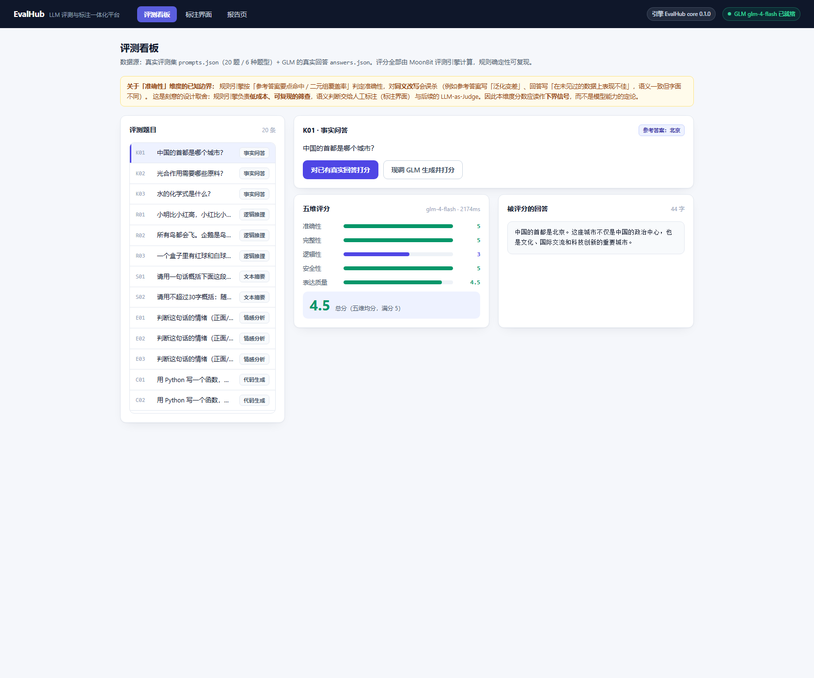
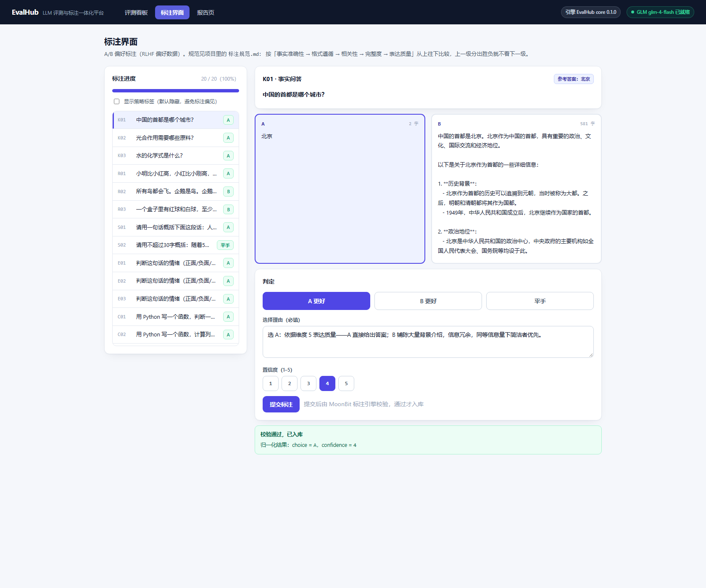
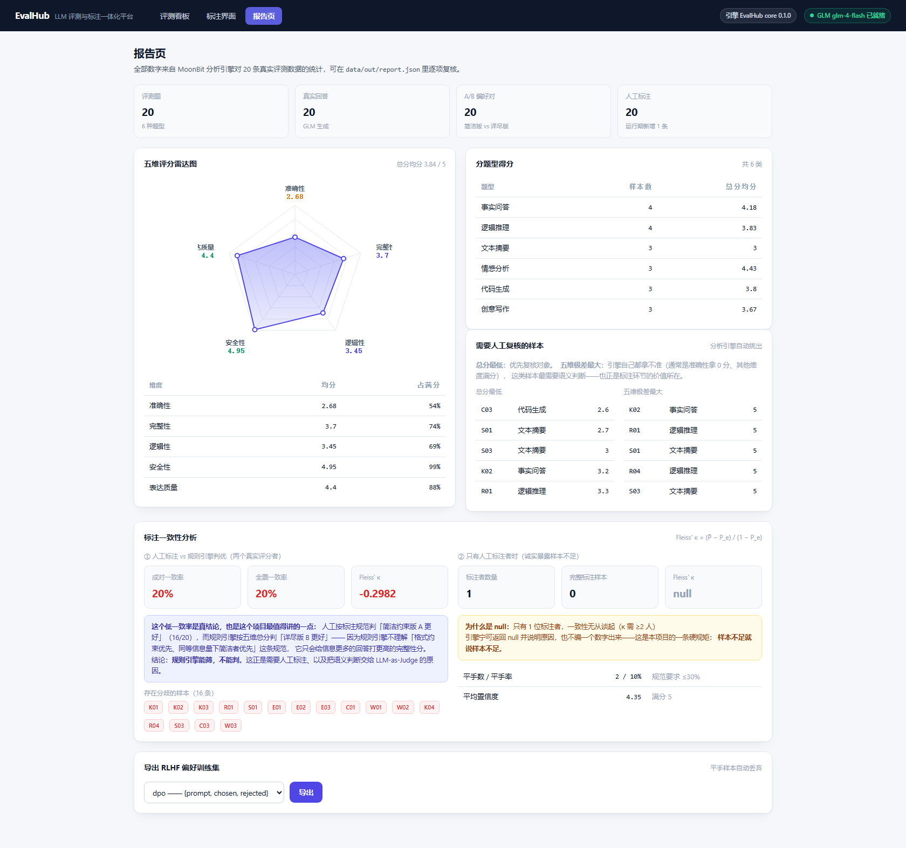
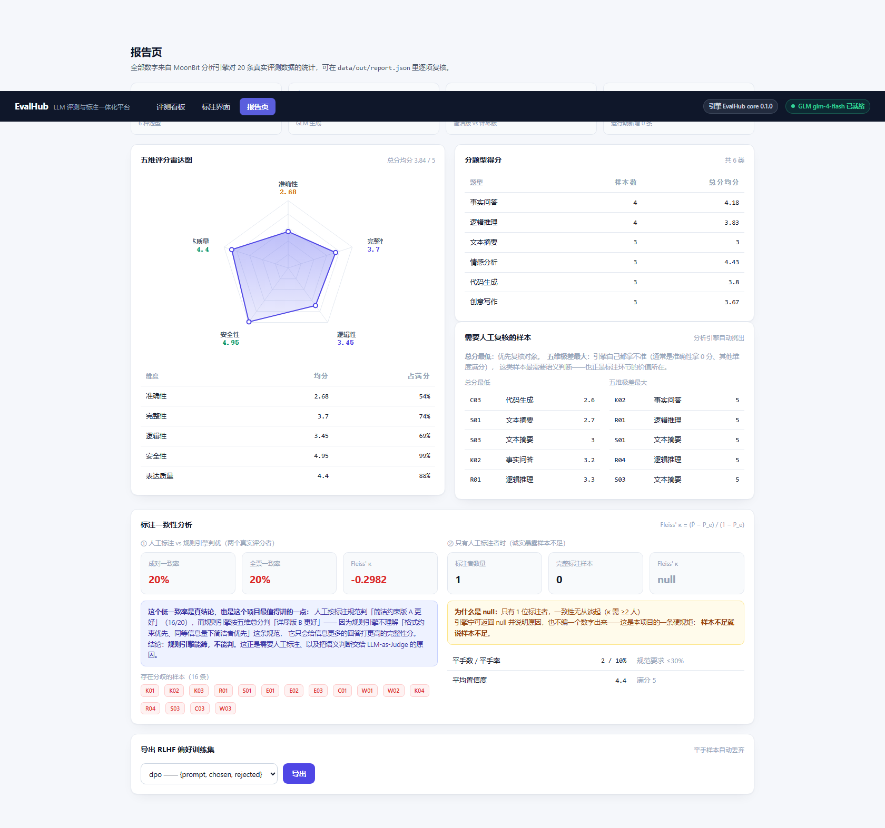

# EvalHub · LLM 评测与标注一体化平台

> **用 MoonBit 写核心引擎，Vue 3 写前端**，让「**评测发现模型问题 → 标注偏好数据 → 生成分析报告 → 导出 RLHF 训练数据**」形成闭环。
>
> 状态：**四个引擎全部完成 + 后端 + 前端全部跑通 + WASM 目标已验证** ｜ 引擎单测 **75/75 通过** ｜ 全部数字来自真实数据，可逐项复现

---

## 一、这个项目解决什么问题

单个「评测脚本」或单个「标注小工具」都只能解决链条的一段。EvalHub 把三段接起来：

| 环节 | 常见做法 | EvalHub 的做法 |
|---|---|---|
| 评测 | 写个 Python 脚本打印分数 | MoonBit 评测引擎，5 维评分 + 确定性规则，可单测、可跨语言调用 |
| 标注 | 用 Excel / Label Studio 标完导 CSV | MoonBit 标注引擎做**入库前校验** + 质检标记（低置信度 / 平手 / 零区分度样本） |
| 分析 | 手工算平均分 | MoonBit 分析引擎出均分、雷达图、争议样本、**Fleiss' κ 一致性** |
| 交付 | 一堆 CSV | MoonBit 数据引擎直接导出 **RLHF 偏好训练集**（DPO / 对话式两种格式） |

**一句话**：评测的结果要能变成标注任务，标注的结果要能变成可训练的偏好数据——这条链路是 AI 训练师 / 数据标注岗的真实工作流。

---

## 二、架构（三层，职责严格不重叠）

```
┌──────────────────────────────────────────────────────────────┐
│  Vue 3 前端（Vite）                                            │
│  评测看板  ·  A/B 标注界面  ·  报告页（手写 SVG 雷达图 + 导出）    │
│                    ↕  HTTP（Vite proxy → 3000）               │
├──────────────────────────────────────────────────────────────┤
│  Node 网关（backend/）                                         │
│  调 GLM API  ·  编排调用  ·  暴露 HTTP 接口                     │
│  ⚠ 不做任何业务计算 —— 规则只在引擎里定义一处                     │
│                    ↕  import（moon build --target js）         │
├──────────────────────────────────────────────────────────────┤
│  MoonBit 核心引擎（core/）—— 本项目的灵魂                        │
│  ┌──────────┬──────────┬──────────┬──────────┐               │
│  │ 评测引擎  │ 标注引擎  │ 分析引擎  │ 数据引擎  │               │
│  └──────────┴──────────┴──────────┴──────────┘               │
│  纯函数：JSON 字符串进 → JSON 字符串出；不碰网络、不碰 DOM          │
└──────────────────────────────────────────────────────────────┘
```

### 为什么这么分层（面试必讲）

1. **引擎是纯函数**：输入输出都是 JSON 字符串，没有全局状态、没有副作用 → 可以脱离网络和浏览器**单测**，也可以被任何语言调用。**这条设计原则已经被验证**：同一套源码除了编成 JS，还编成了自包含的 WASM，两形态输出逐字符一致（见下）。
2. **网关只做编排**：唯一需要网络的环节（调大模型）放在网关，引擎完全不感知网络 → 引擎的测试不需要 mock HTTP。
3. **规则单点定义**：曾被这个问题咬过——网关层「顺手」过滤了一次平手样本，导致导出计数和引擎对不上（详见 `docs/踩坑记录.md` 坑 23）。修正后所有业务规则只在 MoonBit 里写一遍。

### 同一套源码，两种编译目标

引擎源码只写一份，`moon build` 换目标即可：

| 目标 | 产物 | 体积 | 依赖 | 用途 |
|---|---|---|---|---|
| `--target js` | `src.js`（ESM） | 96 KB | 无 | **当前生产路径**，Node 直接 `import` |
| `--target wasm-gc` | `src.wasm` | 171 KB | **0 个导入** | 已验证：可嵌入任何 WASM 宿主 |

**关键难点：WebAssembly 没有跨边界的字符串类型。**

wasm-gc 里 MoonBit 的 `String` 是 GC 结构体，JS 侧既造不出也读不出，直接传会报
`TypeError: type incompatibility when transforming from/to JS`。这是 WASM 的固有边界，
不是 MoonBit 的缺陷——Rust 用 wasm-bindgen、C 用手动指针+长度、Go 用 syscall/js，
每个语言都得自己适配。本版本 MoonBit 不带 JS glue，所以项目自己写了最小适配层
`core/src/engine_wasm_abi.mbt`：**码点缓冲 + 索引寻址，只传 `Int`**。

```
JS 侧                                    MoonBit 侧
abi_clear()                       →      清空缓冲区
abi_push(cp)   × N                →      逐个追加输入码点
abi_run(op)                       →      跑引擎，结果写回缓冲区
abi_len() / abi_read(i)  × N      →      逐个读出输出码点
```

> ⚠️ **一个真踩到的坑**：搬的必须是**码点**（`codePointAt`），不是 UTF-16 码元（`charCodeAt`）。
> MoonBit 的 `Char` 是 32 位完整码点，代理区码元会被 `Int::to_char` 判为非法并替换成 U+FFFD
> ——emoji 就这么丢了。`"加油💪".length()` 是 4（码元）但 `for ch in s` 只迭代 3 次（码点），
> 这个差异是实测出来的。详见 `docs/踩坑记录.md` 坑 29。

正确性不靠「编出来了」宣称，靠两处独立验证：

```bash
node tools/wasm_smoke.mjs    # 用真实数据把两形态输出逐字符比对 → 64 / 64 一致
```

---

## 三、四个引擎的数据契约

全部是 `JSON 字符串 → JSON 字符串`，非法输入返回 `{"error": "..."}` 而不向宿主抛错。

### 1. 评测引擎 `eval_engine`

```jsonc
// 输入
{ "prompt": "水的化学式是什么？", "answer": "水的化学式是H₂O，由两个氢原子和一个氧原子组成。",
  "reference": "H2O", "task_type": "事实问答" }
// 输出
{ "accuracy": 5, "completeness": 5, "logic": 3, "safety": 5, "expression": 4.5, "total": 4.5 }
```

五个维度各有**独立的纯函数**，可插拔、可单测：参考要点命中率（准确性）、要点覆盖度（完整性）、推导与代码结构标记词（逻辑性）、敏感词与拒绝表态（安全性）、题型长度区间 + 结构标点 + 刷字惩罚（表达质量）。

### 2. 标注引擎 `annotate_engine`

```jsonc
// 输入
{ "id": "K01", "answer_A": "...", "answer_B": "...", "choice": "A", "reason": "选 A：…", "confidence": 5 }
// 输出
{ "id": "K01", "valid": true, "errors": [], "flags": [], "choice": "A", "confidence": 5 }
```

- **校验失败**（`valid: false`，拒收）：choice 不在 {A, B, 平手} / reason 为空 / confidence 不是 1–5 的整数 / 缺待比较的回答。
- **质检标记**（不阻断入库，只提示复核）：`low_confidence`、`reason_too_short`、`tie_needs_review`、`identical_answers`。
- choice 做了归一化：大小写、前后空白不敏感，`tie` / `TIE` 都识别为「平手」。

### 3. 分析引擎 `analyze_engine` / `consistency_engine`

```jsonc
// analyze_engine：一批评分 → 均分 / 雷达图 / 分题型 / 需复核样本
{ "count": 20, "skipped": 0,
  "dimensions": { "accuracy": 2.67, "completeness": 3.7, "logic": 3.45, "safety": 4.95, "expression": 4.4 },
  "total": 3.84,
  "radar": [ { "key": "accuracy", "label": "准确性", "value": 2.67, "ratio": 0.54 }, "..." ],
  "by_task_type": [ { "task_type": "事实问答", "count": 4, "total": 4.18 }, "..." ],
  "lowest_total": [ { "id": "C03", "task_type": "代码生成", "total": 2.6 }, "..." ],
  "max_spread":   [ { "id": "R01", "task_type": "逻辑推理", "spread": 5 }, "..." ] }

// consistency_engine：多人标注 → 一致率 + Fleiss' κ
{ "annotators": ["human", "rule_judge"], "items_rated": 20, "items_complete": 20,
  "pairwise_agreement": 0.2, "unanimous_rate": 0.2,
  "fleiss_kappa": -0.2982, "kappa_note": "", "disputed_items": ["K01", "K02", "..."] }
```

**样本不足时返回 `null` 并说明原因，绝不编数字**——例如只有 1 位标注者时：

```json
{ "fleiss_kappa": null, "kappa_note": "只有 1 位标注者，一致性无从谈起（κ 需 ≥2 人）" }
```

### 4. 数据引擎 `export_rlhf`

```jsonc
// 输入
{ "format": "dpo", "annotations": [ { "id": "K01", "prompt": "…", "answer_A": "…", "answer_B": "…", "choice": "A" } ] }
// 输出
{ "format": "dpo", "total": 20, "exported": 18, "dropped": 2,
  "dropped_detail": { "tie": 2, "invalid_choice": 0, "missing_answer": 0, "identical": 0 },
  "data": [ { "id": "K01", "task_type": "事实问答", "prompt": "…", "chosen": "…", "rejected": "…" } ] }
```

转换规则：`choice=A` → `chosen=answer_A`；`choice=B` → 对调；**平手丢弃**（没有偏好信号，喂进去只会教坏模型）；非法 choice / 缺字段 / chosen 与 rejected 相同（零信息样本）一并丢弃并分别计数。

`format=openai` 输出对话式 messages 结构。

---

## 四、快速开始（3 步跑起来）

> 前置：MoonBit CLI（[下载](https://www.moonbitlang.cn/download/)）、Node.js ≥ 18（推荐 22）

### 第 1 步：编译 MoonBit 引擎

```bash
cd core
moon check                          # 类型检查
moon test                           # 单元测试 → Total tests: 75, passed: 75, failed: 0
moon build --target js              # 编译成 ESM JavaScript，供 Node 直接 import
moon build --target wasm-gc         # 可选：编译成自包含 .wasm（171 KB，0 依赖）
cd ..
```

### 第 2 步：起后端（3000 端口）

```bash
cd backend
npm install
node server.js
```

启动后会打印引擎版本、产物路径、以及大模型配置状态。**大模型密钥是可选的**：

- 若 `llm-eval-project/config.json` 里配了 `api_key`，`/api/eval`（调 GLM 生成回答）可用；
- 若没配，其余所有接口（打分 / 标注 / 报告 / 导出）**照样能用**——引擎不依赖网络。

### 第 3 步：起前端（5173 端口）

```bash
cd frontend
npm install
npx vite
```

打开 <http://127.0.0.1:5173>。

### 可选：用真实数据重新生成产物

```bash
node tools/build_dataset.mjs      # 需要先完成第 1 步
```

它会读取真实数据集，跑完四个引擎，把产物写进 `data/out/`（打分 / 报告 / 校验 / RLHF 数据集 / 一致性）。

---

## 五、界面截图

> 截图由 `node tools/capture_screenshots.mjs` 用本机 Edge 无头模式 + CDP 自动生成，**截的是真实交互状态**（真实大模型调用、真实引擎校验反馈）。

### 评测看板 · 现调 GLM 生成回答并打分



左侧是 20 条真实评测题；右侧五维分数条由 MoonBit 评测引擎算出。图上这次是**真实调用 glm-4-flash**（2174ms）后打出的 4.5 分。

### 标注界面 · 提交后引擎校验反馈



A/B 双栏对比（A 版 2 字、B 版 581 字），选偏好 → 填理由 → 选置信度 → 提交。底部绿色条是 **MoonBit 标注引擎返回的校验结果**：`校验通过，已入库 / 归一化结果：choice = A, confidence = 4`。

### 报告页 · 五维雷达图与一致性分析



雷达图是**手写 SVG**（零 ECharts 依赖），数据来自分析引擎对 20 条真实数据的统计。



一致性面板：人工 vs 规则引擎一致率 20%、κ = −0.2982；以及「只有 1 位标注者 → κ = null + 原因」的诚实呈现。

其余截图：`01-eval-board.png`（对已有回答打分）、`03-annotate.png`（标注填写中）、`07-report-export.png`（RLHF 导出结果）。

---

## 六、HTTP 接口一览

| 方法 | 路径 | 作用 | 需要大模型 |
|---|---|---|---|
| GET | `/api/health` | 引擎版本、产物路径、GLM 配置状态（**不含密钥**） | 否 |
| GET | `/api/prompts` | 20 条评测题 + 已存的真实回答 | 否 |
| GET | `/api/dataset` | 20 组 A/B 偏好对 + 当前标注状态 | 否 |
| POST | `/api/score` | 给一段现成回答打五维分 | 否 |
| POST | `/api/eval` | 调 GLM 生成回答 → 引擎打分 | **是** |
| POST | `/api/eval/batch` | 批量评测（串行 + 节流，防限流） | **是** |
| POST | `/api/annotate` | 提交标注（引擎校验通过才入库） | 否 |
| POST | `/api/annotate/check` | 只校验不落库（前端实时提示） | 否 |
| GET | `/api/report` | 汇总报告：均分 / 雷达图 / 一致性 / 标注质量 | 否 |
| GET | `/api/consistency` | 一致性单查 | 否 |
| GET | `/api/scores` | 20 条真实回答的打分明细 | 否 |
| POST | `/api/export` | 导出 RLHF 训练集（`dpo` / `openai`） | 否 |

统一响应壳：成功 `{ ok: true, data: ... }`，失败 `{ ok: false, error: "..." }`。

---

## 七、真实数字（可复现）

全部来自 20 条真实评测题 + 20 条 GLM 真实回答 + 20 组真实 A/B 偏好对 + 20 条真实人工标注。

| 指标 | 数值 |
|---|---|
| MoonBit 引擎单元测试 | **75 / 75 通过** |
| WASM 形态一致性比对 | **64 / 64 通过**（`wasm-gc` 与 `js` 输出逐字符一致） |
| WASM 产物 | **171.4 KB**，12 个导出、**0 个导入**（自包含，无 JS glue） |
| 五维均分 | 准确性 2.67 / 完整性 3.70 / 逻辑性 3.45 / 安全性 4.95 / 表达质量 4.40 |
| 总分均分 | **3.84 / 5** |
| 分题型均分 | 事实问答 4.18 / 逻辑推理 3.83 / 文本摘要 3.00 / 情感分析 4.43 / 代码生成 3.80 / 创意写作 3.67 |
| 标注校验通过率 | **20 / 20** |
| 平手率 | **10.0%**（标注规范要求 ≤30%） |
| 平均置信度 | 4.4 / 5 |
| RLHF 导出 | 20 条标注 → **18 条偏好样本**（丢弃 2 条平手） |
| 人工 vs 规则引擎判优一致率 | 20.0%，Fleiss' κ = **−0.2982** |
| 人工标注者之间的 κ | **null**（只有 1 位标注者，样本不足） |

---

## 八、已知边界与设计取舍（诚实声明）

这个项目刻意把「能算什么、不能算什么」讲清楚，而不是把数字包装得好看。

### 1. 规则引擎能筛，不能判

20 条真实数据上，人工标注与规则引擎判优的**一致率只有 20%，κ = −0.30**。这不是 bug，是真结论：

- 人工按标注规范判「简洁约束版 A 更好」（16/20），因为规范写明「同等信息量下简洁者优先」；
- 规则引擎按五维总分判「详尽版 B 更好」，因为它只会给信息更多的回答更高的完整性分，**它不理解「格式约束优先」这条规范**。

**结论**：规则引擎负责低成本、可复现的**筛查**，语义层面的**判断**必须交给人工标注（本平台的标注界面）与 LLM-as-Judge（后续迭代）。这个低一致率恰好证明了标注环节的价值。

### 2. 准确性维度对「同义改写」会误杀

规则引擎按字符级要点命中判定准确性。参考答案写「泛化变差」、回答写「在未见过的数据上表现不佳」——语义一致但字面不同，规则引擎判不中。

因此准确性维度应读作**下界信号**，不是模型能力的定论。

> 已经修掉的一类真 bug：模型输出常用 Unicode 下标（`H₂O` 的 `₂` 是 U+2082），早期版本判不中，修复后准确性均分从 2.42 升到 2.67、事实问答类从 3.68 升到 4.18。详见 `docs/踩坑记录.md` 坑 20。

### 3. 单人标注无法计算一致性

当前 20 条标注由 1 人完成，**人工之间的 κ 无法计算**。引擎返回 `null` 并给出原因，前端报告页把这句话原样展示。

报告里那个「人工 vs 规则引擎」的一致率是**两个真实评分者**的真实结果，可以直接写进材料——但它衡量的是「人与规则的差异」，不能当成人际一致性。

### 4. 已做与未做

**已做（Wasm 目标已跑通并验证）**

- `moon build --target wasm-gc` 产出 **171.4 KB 自包含 `.wasm`**（12 个导出函数、**0 个导入**，不依赖任何 JS glue）。
- 因为 WebAssembly 没有跨边界字符串类型，额外写了最小适配层 `src/engine_wasm_abi.mbt`（码点缓冲 + 索引寻址，只传 `Int`），把五个引擎搬到 WASM 侧。
- `node tools/wasm_smoke.mjs` 用**真实数据**把两种目标逐字符比对：**64 项全部一致**。含非 BMP 字符（emoji / 生僻字）双向往返用例。详见 `docs/踩坑记录.md` 坑 28–30。

**未做（诚实声明）**

- 生产环境仍跑 JS 目标。WASM 形态是**已验证可行的能力**，不是当前运行路径——后端直接 `import` JS 产物更简单，WASM 的价值在于「引擎可脱离 JS 运行时、以二进制形态嵌入任何宿主」。
- 后端未接 WASM。若要用，`tools/wasm_smoke.mjs` 里的 `wasmCall()` 就是现成的调用封装。
- LLM-as-Judge：接口层已预留（评测引擎的可插拔断言设计就是为它准备的），本期未接。
- 多人标注流程：数据结构与算法已就绪（`consistency_engine` 支持任意多标注者），缺的是第二个真人标注者。

---

## 九、目录结构

```
evalhub/
├── core/                     # MoonBit 核心引擎（本项目灵魂）
│   ├── moon.mod
│   └── src/
│       ├── engine_eval.mbt        评测引擎（5 维评分）
│       ├── engine_annotate.mbt    标注引擎（校验 + 质检标记）
│       ├── engine_analyze.mbt     分析引擎（统计 + 一致性 + 雷达图）
│       ├── engine_data.mbt        数据引擎（RLHF 导出）
│       ├── engine_wasm_abi.mbt    WASM 跨边界适配层（码点缓冲 ABI）
│       ├── moon.pkg               ← JS / wasm-gc 双目标导出配置
│       └── *_wbtest.mbt           白盒单测（75 个用例）
├── backend/                  # Node 网关
│   ├── engine.js                  加载 MoonBit 编译产物
│   ├── glm.js                     GLM 客户端（密钥只从本地配置读 + 请求节流）
│   ├── store.js                   数据仓库（真实数据 + 运行期标注）
│   └── server.js                  HTTP 接口
├── frontend/                 # Vue 3 + Vite
│   └── src/
│       ├── App.vue                顶部导航 + 后端健康状态
│       ├── api.js                 接口封装
│       ├── components/            ScoreBars（五维分数条）/ RadarChart（手写 SVG 雷达图）
│       └── views/                 EvalBoard / AnnotateView / ReportView
├── tools/
│   ├── build_dataset.mjs     真实数据管道（跑四引擎 → 写 data/out/）
│   ├── capture_screenshots.mjs  用本机 Edge 无头 + CDP 自动生成界面截图
│   ├── engine_smoke.mjs      Node import MoonBit 引擎的跨语言冒烟测试
│   └── wasm_smoke.mjs        WASM 与 JS 两形态逐字符比对（64 项）
├── data/                     真实数据快照 + 引擎产物（可复现）
├── docs/
│   ├── 踩坑记录.md           30 条真实报错与解法（面试弹药）
│   └── screenshots/          界面截图（由脚本自动生成）
├── verify.bat                Windows 一键验收
├── LICENSE                   MIT
└── README.md
```

---

## 十、数据来源声明

`data/` 下的数据来自本仓库作者的另外两个真实项目，**原文件只读、未做任何修改**：

| 文件 | 来源 | 内容 |
|---|---|---|
| `prompts.json` | `llm-eval-project/prompts.json` | 20 条评测题，6 种题型，含参考答案 |
| `answers.json` | `llm-eval-project/outputs/answers.json` | GLM 对 20 题的真实回答 |
| `pairs.json` | `data-annotation-project/data/pairs.json` | 20 组 A/B 偏好对（简洁约束版 vs 详尽展开版） |
| `annotations.json` | `data-annotation-project/annotations/annotations_summary.csv` | 20 条人工标注（choice / reason / confidence） |

`data/out/` 是引擎跑出来的产物，可用 `node tools/build_dataset.mjs` 一键重新生成。

---

## 十一、借鉴声明

架构设计借鉴以下开源项目，**代码为原创实现**：

| 项目 | 借鉴了什么 |
|---|---|
| [Label Studio](https://github.com/HumanSignal/label-studio) | 标注平台「项目 → 任务 → 标注 → 质检 → 导出」的完整工作流 |
| [Promptfoo](https://github.com/promptfoo/promptfoo) | 声明式配置 + **可插拔断言引擎**（本项目把它落成「每个维度一个独立纯函数」） |
| [EvalScope](https://github.com/modelscope/evalscope) | Web 看板 + 报告可视化 |

---

## 十二、License

[MIT](./LICENSE)
